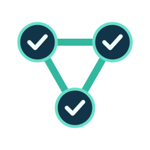

<p align="center">
  
</p>

<h1 align="center">edbfi-ci</h1>

<p align="center"><strong>Shared CI templates, policy hooks, and review automation for edbfi repositories.</strong></p>

<p align="center">
  <a href="https://github.com/edbfi/edbfi-ci/blob/main/LICENSE"></a>
  <a href="https://github.com/python/cpython" title="CPython source"></a>
  <a href="https://github.com/actions/runner" title="GitHub Actions runner source"></a>
  <a href="https://github.com/j178/prek"></a>
</p>

Shared CI for the edbfi repos: workflow, Dependabot and prek templates, two shared prek hooks and the Pullfrog review workflow. Each repo carries its own copy of the templates, and its Dependabot PRs, majors included, merge on their own once CI passes. Changing a template here doesn't update the copies.

## Principles

1. **No human in the loop** where automation can do it safely.
2. **No holds:** no Dependabot `ignore:` entries or pinned-back versions; a broken upstream release keeps its PR red until a later release fixes it. An unavoidable exception is named at the pin, with its upstream issue.
3. **Upstream mechanisms over custom code:** Dependabot, GitHub and prek first; custom code only for what none of them does, in one copy, here.

## Scope

Every public edbfi repo with a `ci.yml` and `pr-policy.yml`; repo-patches only for its tooling. Out of scope: the [Hotio family](AGENTS.md#hotio-family), which keeps Hotio's CI, the private dox notes and archived repos.

## Layout

- `templates/`: each file's header says where to copy it; [SETUP.md](SETUP.md) covers a new repo.
- `hooks/` and [`.pre-commit-hooks.yaml`](.pre-commit-hooks.yaml): `privileged-jobs` and `check-peers`. Cut a `vX.Y.Z` tag only when these change; consumers pin the tag's frozen SHA and Dependabot moves it.
- `tools/`: template lints and tests, `sync_pullfrog.py`, and `bun_maintenance.py`, run daily by `bun-maintenance.yml`: Bun runtime-bump and audit-fix PRs, which Dependabot can't open (dependabot-core#4830; no Bun security updates).

## Local checks

```sh
uv sync --locked
prek run --all-files --hook-stage manual
```

## License

Except where otherwise noted, original edbfi-ci code and artwork is free software: you can redistribute it and/or modify it under the terms of the [GNU Affero General Public License](LICENSE) as published by the Free Software Foundation, either version 3 of the License, or (at your option) any later version (`AGPL-3.0-or-later`).

Third-party code and assets retain their existing license notices, including the MIT-licensed PhrozenByte workflow script.
